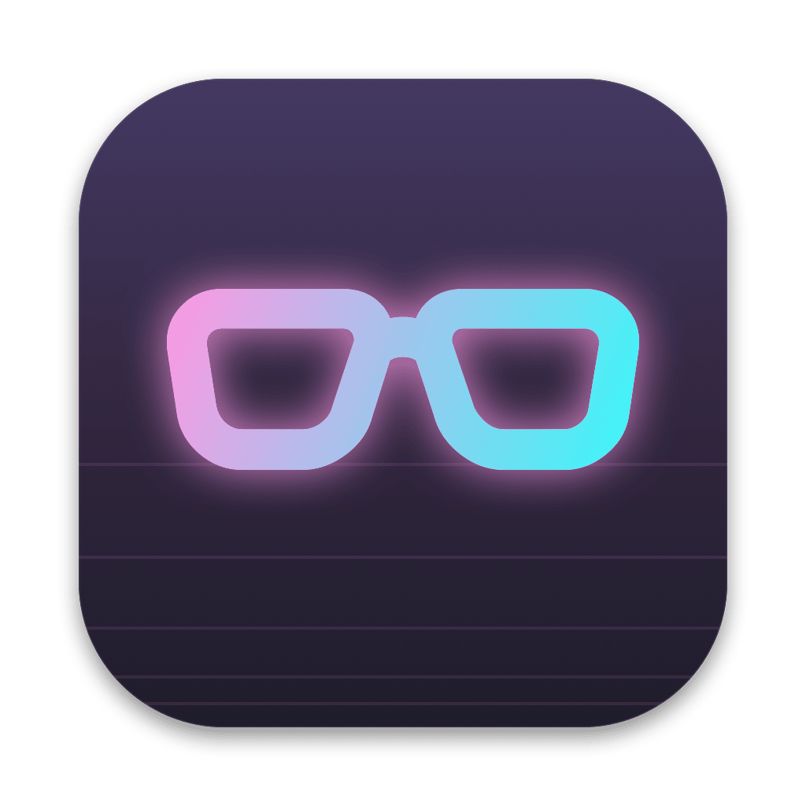

# NerdrKeys

A tiny macOS menu bar app that shows your [herdr](https://herdr.dev) keyboard shortcuts.

Click the glasses icon in the menu bar to open a cheat sheet of:

- **Your shortcuts**: every `[[keys.command]]` in your herdr config, with readable names for known plugin actions
- **herdr's built-in keys**: panes, tabs, workspaces and general, including any you've remapped under `[keys]`

It re-reads `~/.config/herdr/config.toml` (or `$HERDR_CONFIG_PATH`) each time it opens, so new bindings show up without rebuilding. Type in the filter box to narrow the list.

**Text size:** use **A−** / **A+** at the bottom of the popup (10% steps, 80%–160%), or click the percentage to reset. The size is remembered between launches. From Terminal: `defaults write local.nerdrkeys textScale 1.2`.

## Build and install

Needs macOS 13+ and the Swift compiler from Xcode or the Command Line Tools (`xcode-select --install`).

```bash
./build.sh
```

This compiles `main.swift`, bundles the font, installs `NerdrKeys.app` to `~/Applications` and launches it.

To see what the app parses from your config without opening the popover:

```bash
~/Applications/NerdrKeys.app/Contents/MacOS/NerdrKeys --dump
```

## Font

The app's text uses **Hurmit Nerd Font Light** if it's installed on your Mac (install [Fonts/HurmitNerdFont-Light.otf](Fonts/HurmitNerdFont-Light.otf) by double-clicking it), and the system font otherwise. The font is not bundled, which keeps the app small.

The menu bar icon is the `md-glasses` glyph (`U+F02AA`) from Hurmit Nerd Font, stored in the code as its outline, so it shows up whether or not the font is installed.

## App icon



The Finder/Spotlight icon is drawn in code by [icon/draw.swift](icon/draw.swift) from the same glasses outline, and the generated `AppIcon.icns` is committed, so `./build.sh` doesn't need to redraw it. To change the design, edit `draw.swift` and run `./icon/make-icon.sh`. That script needs `pngquant` (`brew install pngquant`) because it reduces each size to a 256-colour palette, which takes the icon from about 750 KB to about 115 KB with no visible difference at icon sizes.

Hurmit Nerd Font is a patched version of Hermit by Pablo Caro, licensed under the SIL Open Font License 1.1. See [Fonts/OFL-LICENSE.txt](Fonts/OFL-LICENSE.txt).

## Roadmap

- v2: note tabs for free-typed text, saved as plain files

## Footprint

About 0.4 MB on disk (0.26 MB program + 0.11 MB icon), about 14 MB of memory, 0% CPU when idle. It runs nothing in the background, opens no network connections, and only reads your herdr config when you click the icon.
